<div align="center">

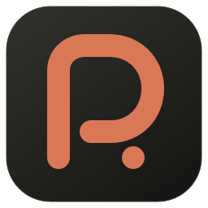

# Agent Pulse

**Quotas, live tasks, interactive approvals, and local usage for Codex, Claude Code, Grok CLI, and Google Antigravity — unified in your menu bar and MacBook notch.**

[简体中文](README.md) · [Download v2.2.0](https://github.com/suguxiaojie/agent-pulse/releases/tag/v2.2.0) · [MIT License](LICENSE)

macOS 13+ · Native SwiftUI / AppKit · Apple Silicon (`arm64`) & Intel (`x86_64`)

</div>

Agent Pulse (formerly Codex Pulse) is a native macOS menu bar and Dynamic Island monitor for AI coding agents. Official quotas come from your local Codex App Server, Claude Code status line, official xAI `grok` billing queries, and Google Antigravity's `agy` status line. Live tasks and interactive prompts flow through desktop IPC, isolated named Hooks, or process-verified local leader sockets. **Agent Pulse never reads, stores, or transmits account credentials or emails, and never silently auto-approves tool execution.**

**v2.2.0 (Build 37)** adds idle Dynamic Island sync with the last finished agent (top-left quota & pixel mascot), multi-provider quota reset/recovery alerts (when consumed to ≤80%) across Claude Code, Grok CLI, and Antigravity, Claude Code multi-account isolated directory tracking, plus fixes for Antigravity completion confetti timing and refresh button flicker.

---

## Dynamic Island

The expanded island keeps a single focus card showing task phase, locked turn duration, up to three recent tool steps, and turn Token usage; concurrent sessions line up as compact capsules below. Each agent features its own pixel mascot (Codex terminal badge, Claude Clawd, Grok Bot, and Antigravity's levitating star-core).

<p align="center">
  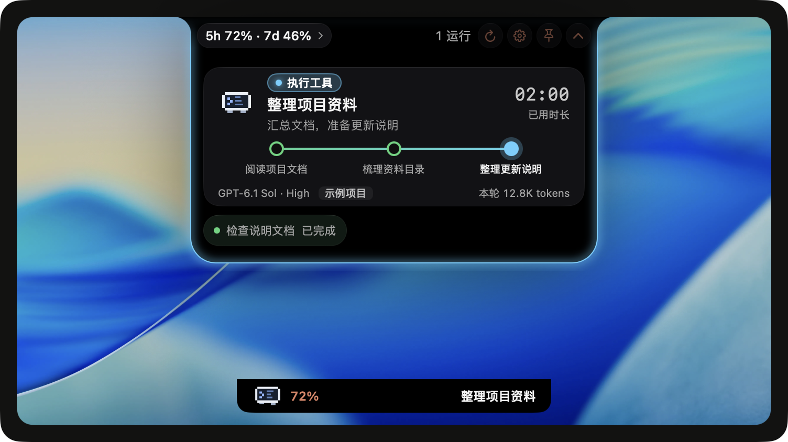
</p>

Incoming approvals and `ask_question` prompts take focus automatically, while clicking the top-left quota capsule opens the uniform `572pt` four-provider Bento usage dashboard right inside the island.

<p align="center">
  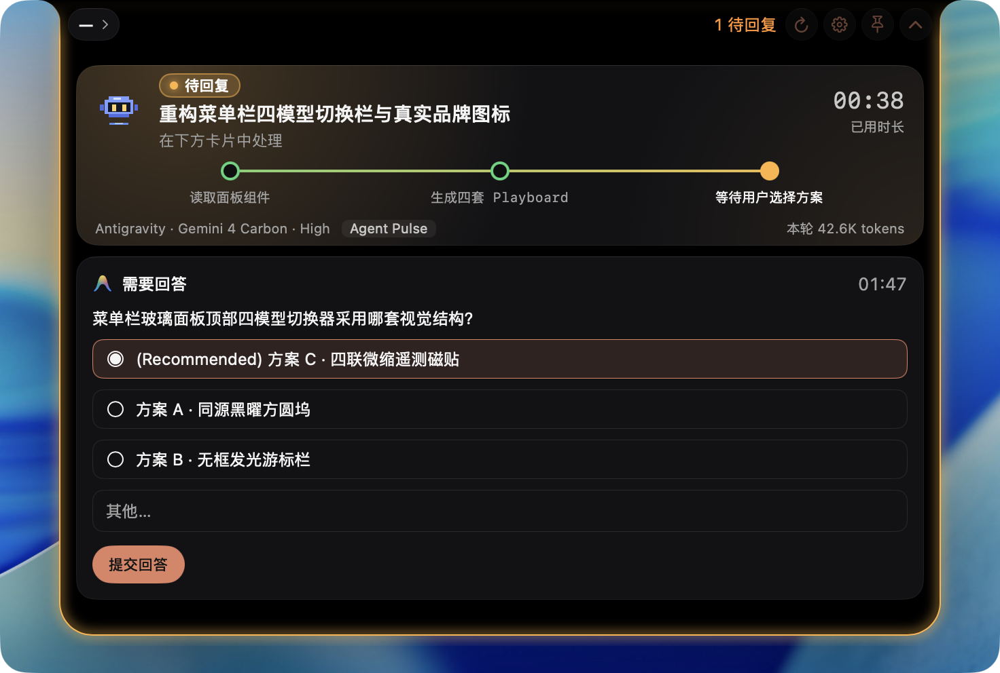
  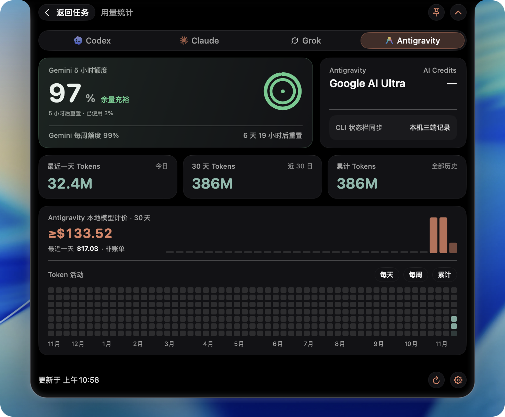
</p>

- **Inline Q&A & Explicit One-Shot Approvals**: Answer `ask_question` prompts and approve or reject sensitive tool calls once across Codex (desktop IPC & turn-scoped OneNative App Servers), Claude Code, Grok CLI, and Google Antigravity. Original option IDs are preserved with no persistent grants; disconnects or timeouts always fail-safe back to the native client without auto-approval.
- **Zero-Jitter Four-Provider Usage Stage**: Switch across Codex, Claude, Grok, and Antigravity with authentic vector marks, dual concentric quota rings, a 30-day cost bar chart, and a single-screen Token activity heatmap locked to an identical height across all providers.
- **Completion Receipts & Multi-Agent Reset Alerts**: Completed turns lock their exact runtime and expire cleanly after 60 seconds, with optional completion audio and three confetti presets. Idle Dynamic Island quota and pixel mascot automatically sync to the last finished agent; quota reset/recovery reminders (≤80% consumed) across Codex, Claude Code, Grok CLI, and Antigravity, plus Codex reset-credit reminders (24h / 12h / 6h before expiry) notify both macOS Notification Center and the island.

---

## Weather Glass Menu Bar Panel

Click the menu bar icon to open the `296pt` Weather Glass Panel. The header features **Four-Provider Telemetry Tiles** — letting you scan live remaining percentages and micro progress bars for **Codex, Claude, Grok, and Antigravity** at a glance before clicking any tile to inspect details.

<p align="center">
  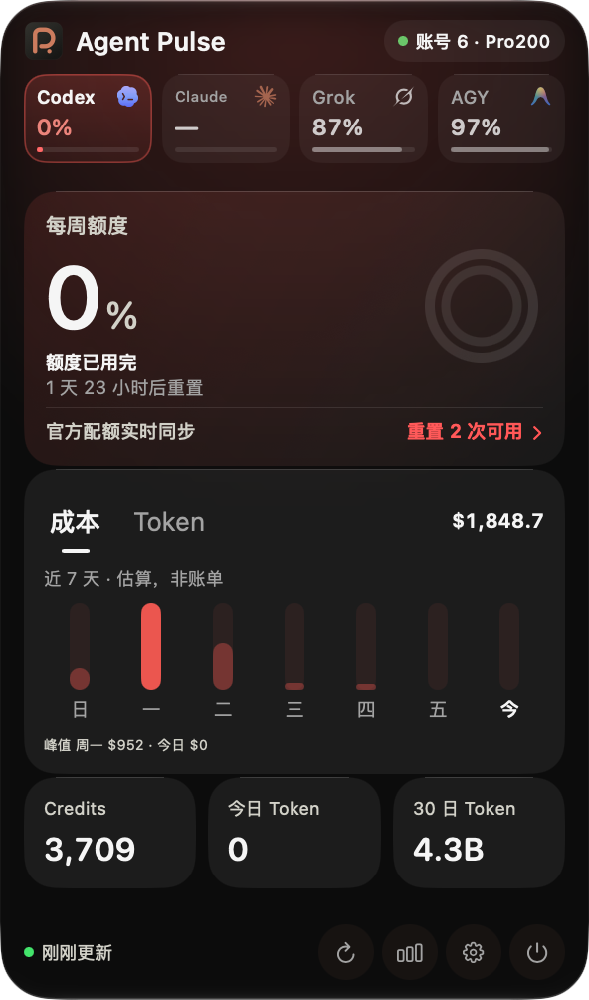
  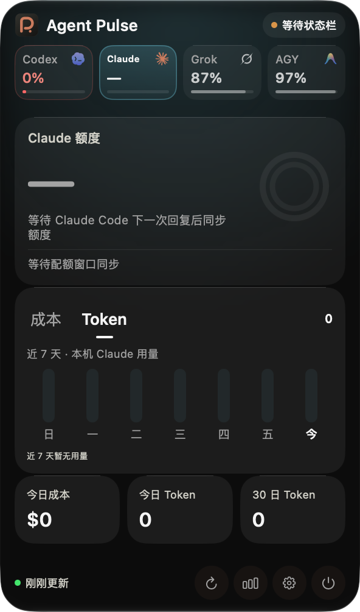
  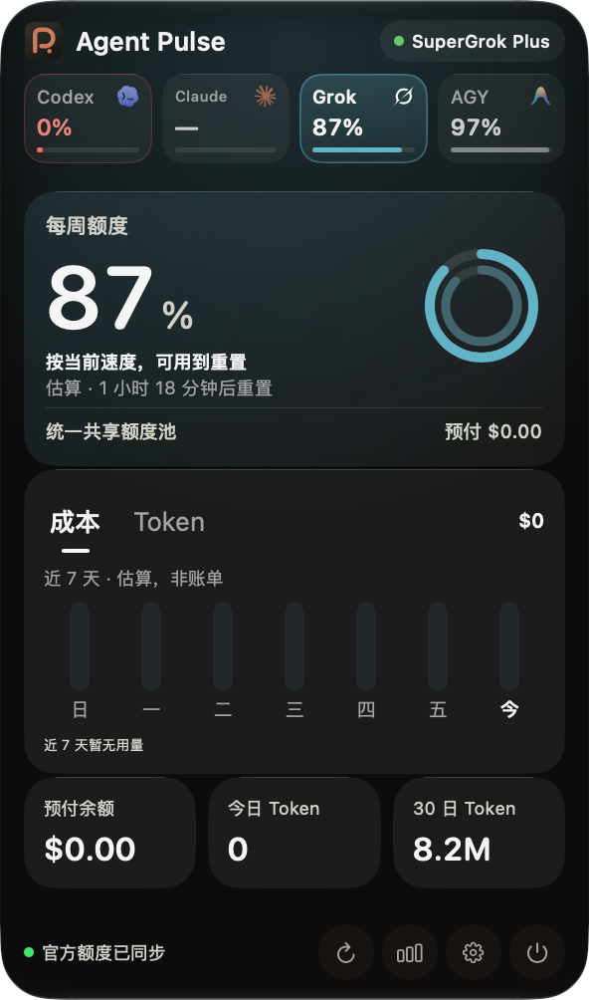
  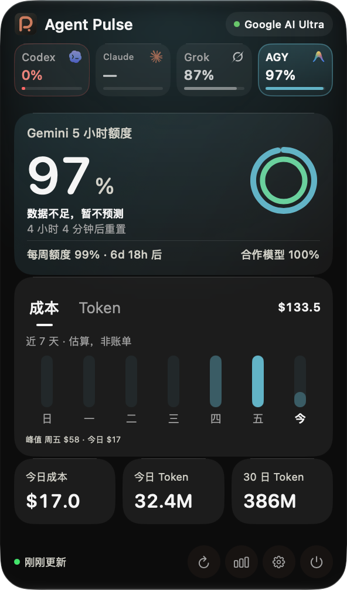
</p>

- **Weather-Tinted Concentric Rings**: Ambient glow and tile highlights shift smoothly across calm cyan, tight amber, and critical crimson based on pace forecasts, paired with outer and inner concentric rings for primary and secondary windows.
- **Provider-Native Semantics**:
  - **Codex**: Personal plan tiers (Go / Plus / Pro100 / Pro200 / Pro500), burn-rate forecasts, Credits, and inline quota-reset entry;
  - **Claude Code**: 5-hour and weekly windows with automatic rollover detection;
  - **Grok CLI**: Shared subscription pool kept distinct from prepaid balance;
  - **Google Antigravity**: Gemini 5h/weekly pools and partner model pools separated from AI Credits.
- **7-Day Cost & Token Strip**: Toggle between estimated API-equivalent cost and Token volume, flagging days that include unpriced models.

---

## Monitor Center

Monitor Center brings multi-window usage analytics, API-equivalent cost breakdowns, community reset radar, session continuity, and four coding-agent integrations into one dark-glass desktop window.

<p align="center">
  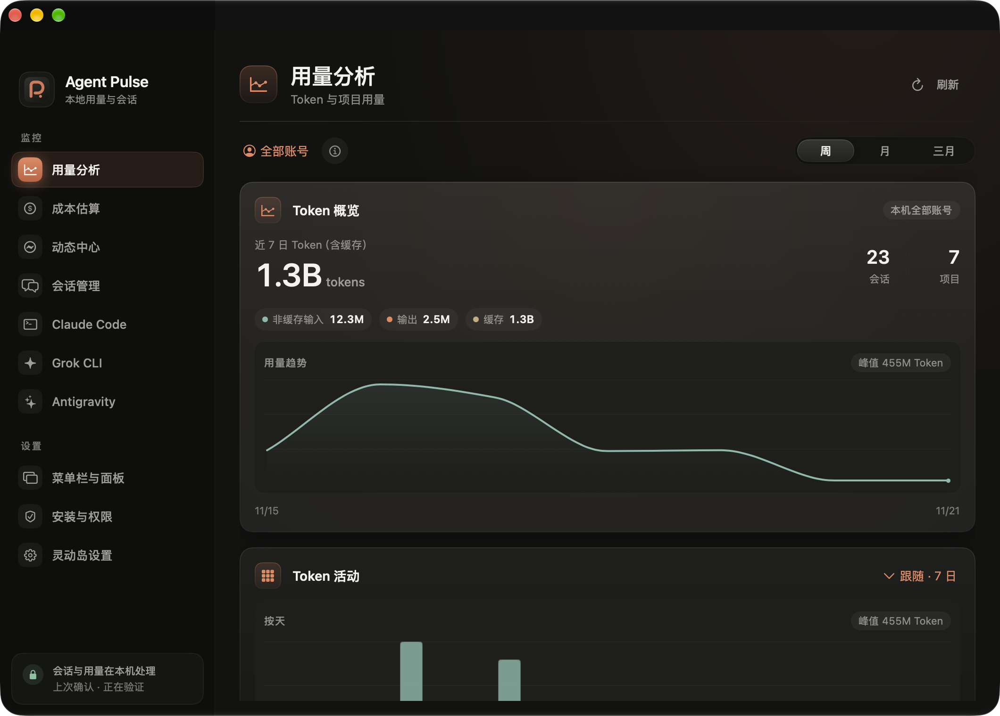
  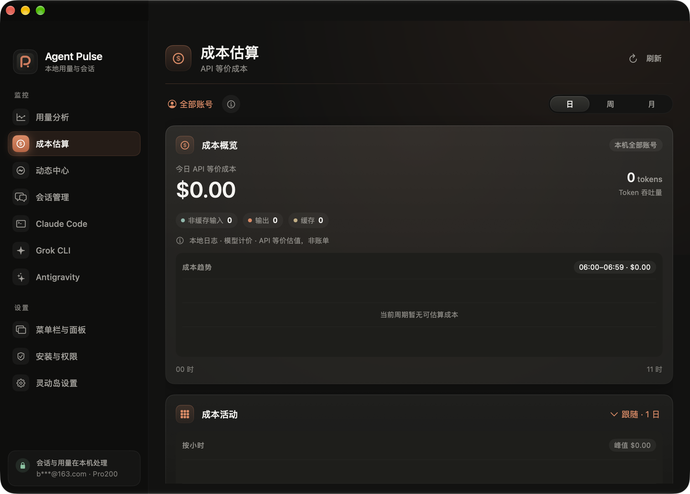
</p>
<p align="center">
  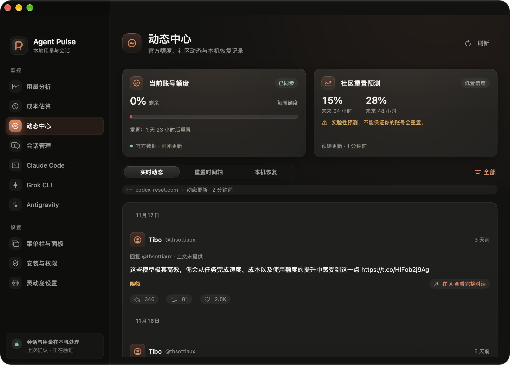
  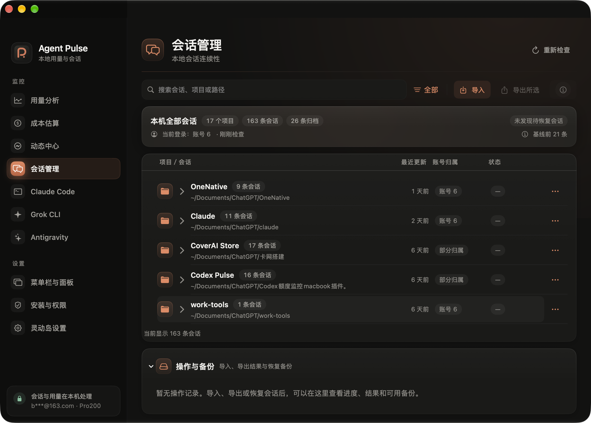
</p>
<p align="center">
  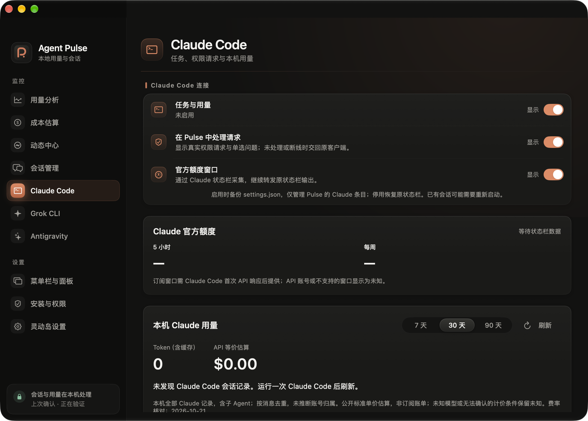
  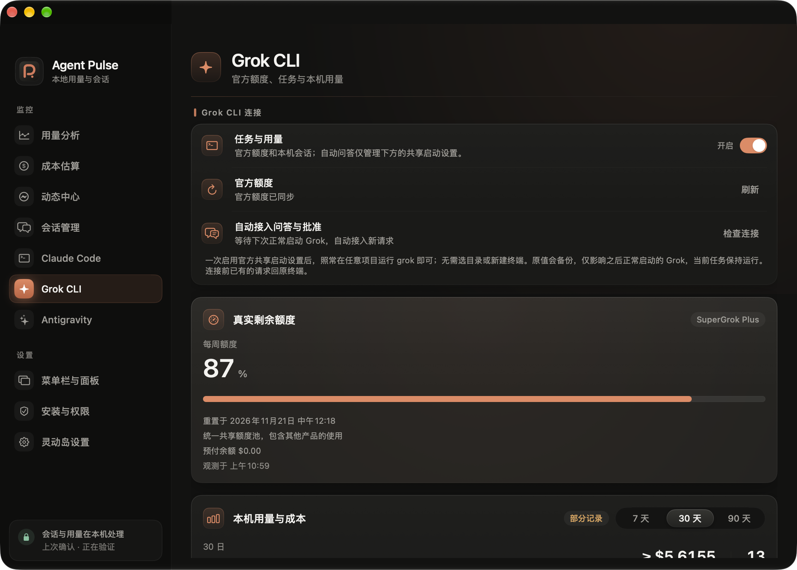
</p>
<p align="center">
  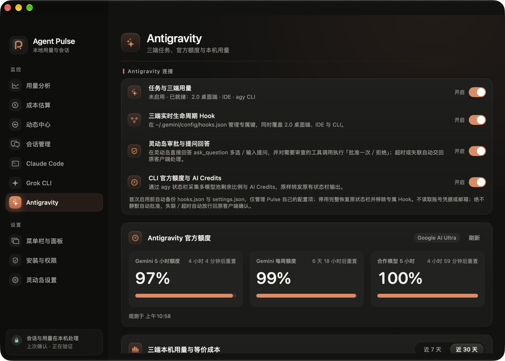
</p>

- **Usage & Cost Analytics**: Inspect Token volume, cache ratios, and project rankings by week, month, or quarter. Costs for Codex, Claude, and Antigravity are estimated from public official API rates (not subscription invoices), with unpriced models surfaced honestly as `≥` lower bounds.
- **Session Continuity**: Search, export to Markdown or HTML, back up raw logs, migrate folders, rename registered Codex projects via the running desktop service, or move verified standalone project folders to Trash with multi-step path safety checks.
- **Reversible, Isolated Agent Integrations** (all disabled by default; existing configs are backed up before first edit):
  - **Claude Code**: Manages only Pulse-marked entries in `settings.json` and restores your original status line when disabled. See [Claude Code integration](docs/claude-code-integration.md).
  - **Grok CLI**: Manages only `cli.use_leader` in `$GROK_HOME/config.toml` and attaches to live same-UID `leader` sockets without restarting standalone terminals. See [Grok CLI integration](docs/grok-cli-integration.md) and [island question boundaries](docs/grok-island-questions.md).
  - **Google Antigravity**: Scans local transcripts and SQLite summaries across 2.0 Desktop, IDE, and `agy` CLI (filtering subagents and checking `presence/*.lock` `flock` liveness), with optional `"codex-pulse"` hooks in `~/.gemini/config/hooks.json` and `agy` status-line forwarding. Local policy gates let routine operations proceed at sub-millisecond speed while surfacing `ask_question` and review-required tools in the Dynamic Island. See [Google Antigravity integration](docs/antigravity-integration.md).

---

## Settings & Permissions

Customize Dynamic Island materials, edge lighting, mascot size, glass panel modules, and number formatting (`万／亿` or `K / M / B`) with live production previews.

<p align="center">
  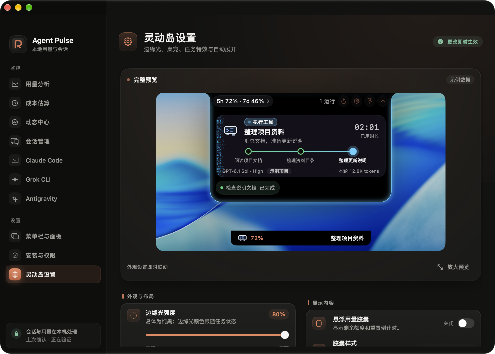
  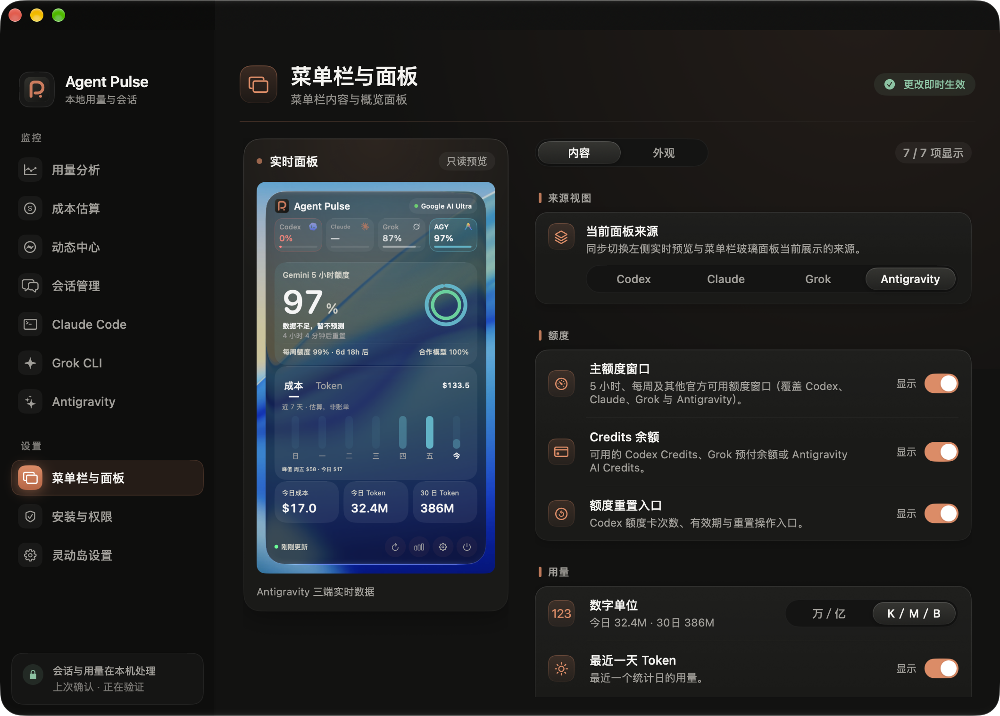
</p>

<details>
<summary>Installation & Permissions (v2.2.0 · Build 37)</summary>
<p align="center">
  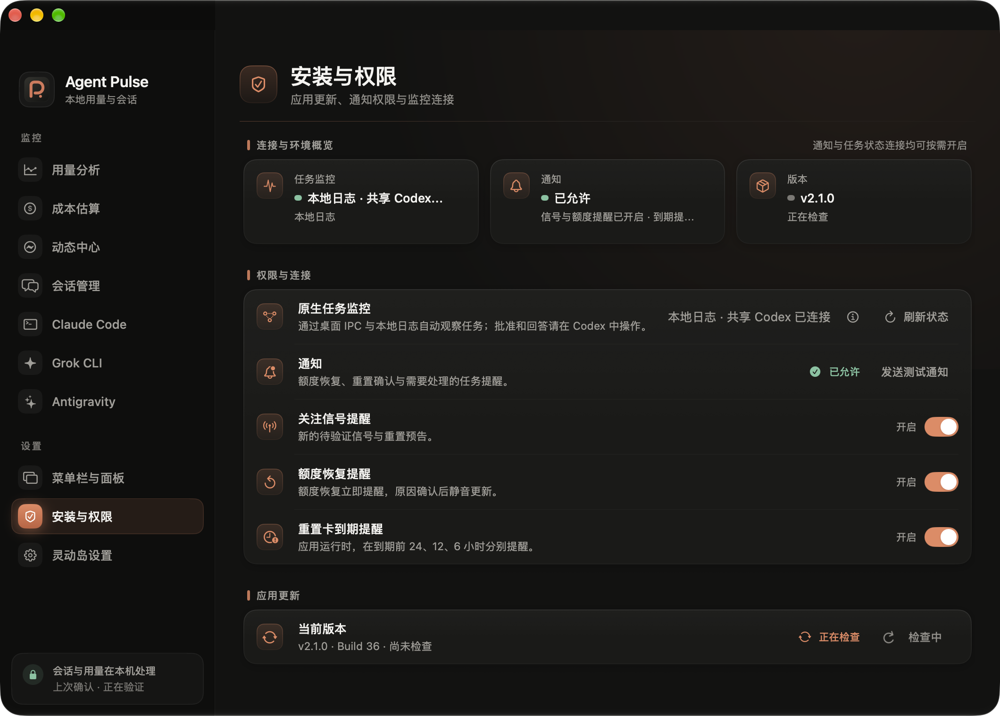
</p>
</details>

---

## Download & Install

Download the installer matching your Mac from [GitHub Releases (`v2.2.0`)](https://github.com/suguxiaojie/agent-pulse/releases/tag/v2.2.0):

| Mac Processor | Installer |
|---|---|
| **Apple Silicon (M1 / M2 / M3 / M4)** | [CodexNotchMonitor-v2.2.0-arm64.dmg](https://github.com/suguxiaojie/agent-pulse/releases/download/v2.2.0/CodexNotchMonitor-v2.2.0-arm64.dmg) |
| **Intel (`x86_64`)** | [CodexNotchMonitor-v2.2.0-x86_64.dmg](https://github.com/suguxiaojie/agent-pulse/releases/download/v2.2.0/CodexNotchMonitor-v2.2.0-x86_64.dmg) |

1. Open the `.dmg` and drag **Agent Pulse** (`CodexNotchMonitor.app`) into `/Applications`.
2. Launch the app. Codex quotas require a signed-in Codex or ChatGPT Desktop app; Claude Code, Grok CLI, and Google Antigravity can be enabled anytime in Monitor Center.
3. Builds are ad-hoc signed and not notarized by Apple. If Gatekeeper prompts on first launch, verify `SHA256SUMS-v2.2.0.txt` on the Release page and allow the app in **System Settings → Privacy & Security**.
4. Bundle ID (`com.coverai.codex-notch-monitor`), executable name, preferences, and local data directories remain unchanged across upgrades from Codex Pulse.

---

## Data Sources & Privacy Boundaries

| Area | Source & Guarantee |
|---|---|
| **Official Quotas & Plans** | Local Codex App Server, Claude status line, official `grok` `_x.ai/billing`, and Antigravity `agy` status line (`email` and unknown fields stripped) |
| **Zero Credential Access** | **Never reads, saves, or uploads** `auth.json`, `.pbtxt`, OAuth tokens, cookies, API keys, or Keychain secrets |
| **Live Tasks & Approvals** | Codex desktop IPC / turn-scoped OneNative proxy; isolated Claude & Antigravity Hooks (2-minute cap, fail-safe passthrough); same-UID Grok `leader` sockets |
| **Tokens & Equivalent Cost** | Read-only local session logs (internal model `thinking` text is not read); costs are public API-rate estimates, not subscription charges |

---

## Build & Verify from Source

```bash
# Run full unit and end-to-end regression suite (Codex / Claude / Grok / Antigravity)
zsh scripts/test.sh

# Build native Release app bundle or architecture-specific DMGs
zsh scripts/build-app.sh arm64
zsh scripts/build-dmg.sh arm64
zsh scripts/build-dmg.sh x86_64
```

## License

Released under the [MIT License](LICENSE). Third-party attributions are listed in [Resources/ThirdPartyNotices.txt](Resources/ThirdPartyNotices.txt).
