<div align="center">

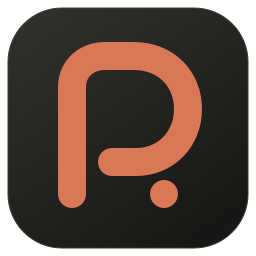

# Agent Pulse

**在菜单栏与刘海灵动岛里，统一看清 Codex、Claude Code、Grok CLI 与 Google Antigravity 的官方额度、实时任务、交互问答与本机用量。**

[English](README.en.md) · [下载 v2.2.0](https://github.com/suguxiaojie/agent-pulse/releases/tag/v2.2.0) · [MIT License](LICENSE)

macOS 13+ · 原生 SwiftUI / AppKit · Apple Silicon (`arm64`) & Intel (`x86_64`)

</div>

Agent Pulse（原 Codex Pulse）是一款原生 macOS 菜单栏与刘海灵动岛监控工具。官方额度来自本机 Codex App Server、Claude 状态栏、xAI 官方 `grok` 查询与 Google Antigravity `agy` 状态栏；实时任务与交互请求来自桌面 IPC、隔离命名 Hook 或经进程核对的本地共享通道。**全程不读取、不存储账号凭据或邮箱，绝不静默自动批准权限。**

当前版本 **v2.2.0（Build 37）** 新增灵动岛静默态自动跟随末次完成任务的代理（左上角额度与像素桌宠同步）、Claude／Grok／Antigravity 消耗至 ≤80% 到点重置与恢复提醒、Claude Code 多账号隔离目录统计支持，并修复 Antigravity 完成烟花触发时机与刷新跳闪。

---

## 灵动岛（Dynamic Island）

展开态只保留一张焦点任务卡片：实时展示当前状态、本轮耗时、最近 3 个工具步骤与本轮 Token；其余并发会话收纳为底部胶囊，点击即可切换。四家编程代理各自拥有专属像素桌宠（Codex 终端光标、Claude Clawd、Grok Bot 与 Antigravity 浮游星核）。

<p align="center">
  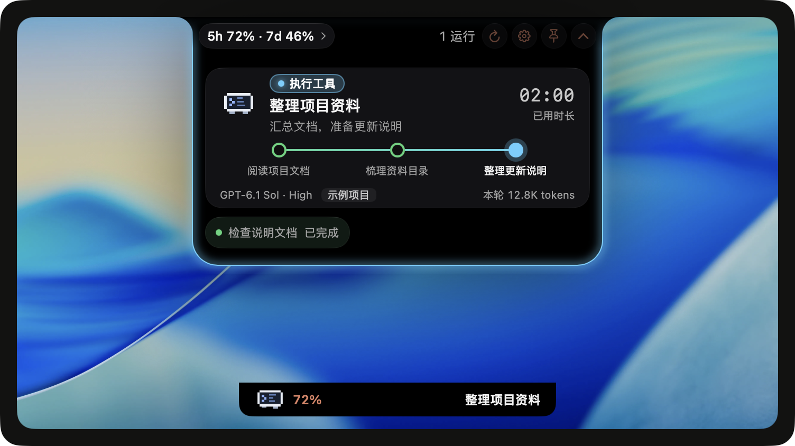
</p>

遇到需要确认的工具调用或 `ask_question` 提问时，灵动岛自动接管焦点；点击左上角额度胶囊则在同一套 `572pt` 统一高度 Bento 舞台内查看四端用量统计。

<p align="center">
  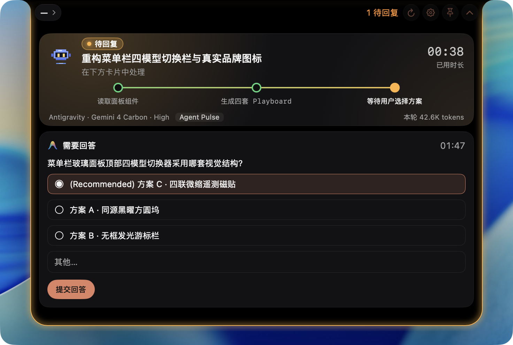
  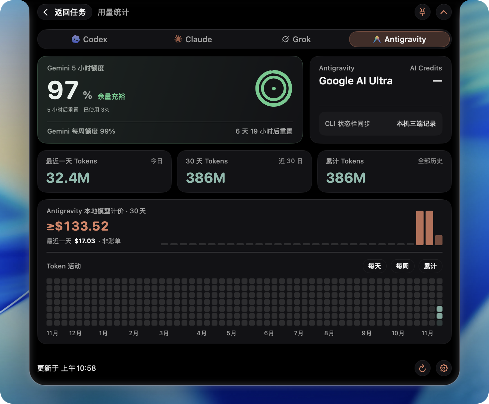
</p>

- **岛内直接回答与显式单次审批**：支持 Codex（桌面 IPC 与 OneNative 活动轮次约束）、Claude Code、Grok CLI 与 Google Antigravity 的真实提问回答及工具「批准一次／拒绝」；保留原生选项 ID，不生成长期授权，断线或超时一律 Fail-Safe 交回原客户端处理，不会自动批准。
- **四端统一等高用量面板**：顶部四家真实品牌徽标一键切换，同心双环表盘同时呈现主副窗口（如 5 小时与每周额度），底部集成 30 日成本柱图与单屏自适应 Token 热力图，跨模型切换零高度跳动。
- **完成反馈与多端重置提醒**：任务完成后在 60 秒留存期内锁定真实轮次耗时并支持可选提示音与三档礼花；静默态左上角剩余额度与像素桌宠自动跟随最后一个完成任务的代理；Codex、Claude Code、Grok CLI 与 Antigravity 额度消耗至 ≤80% 后到点重置或恢复，以及 Codex 重置卡到期前 24／12／6 小时同步推送系统通知与岛内提醒卡片。

---

## 菜单栏气象玻璃面板（Weather Glass Panel）

点击菜单栏图标展开 `296pt` 气象玻璃面板。顶栏采用 **四联微缩遥测磁贴** —— 无需来回切页即可同屏直看 **Codex、Claude、Grok、Antigravity** 四家实时剩余百分比与微进度条，点击任一磁贴平滑切换下方详情。

<p align="center">
  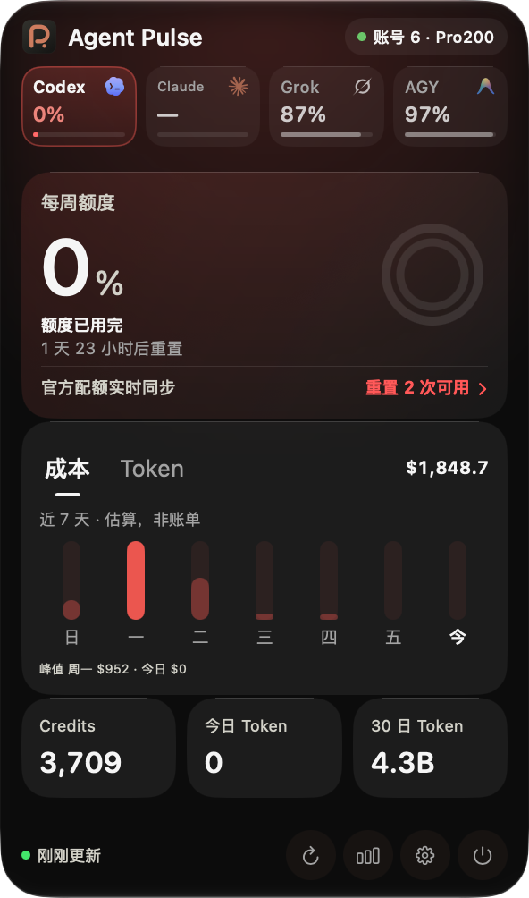
  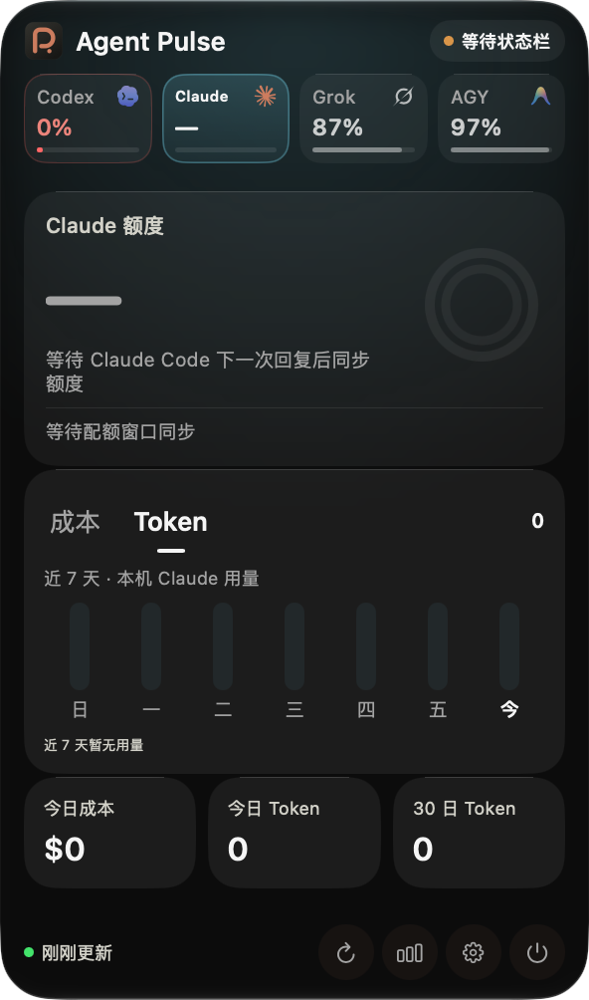
  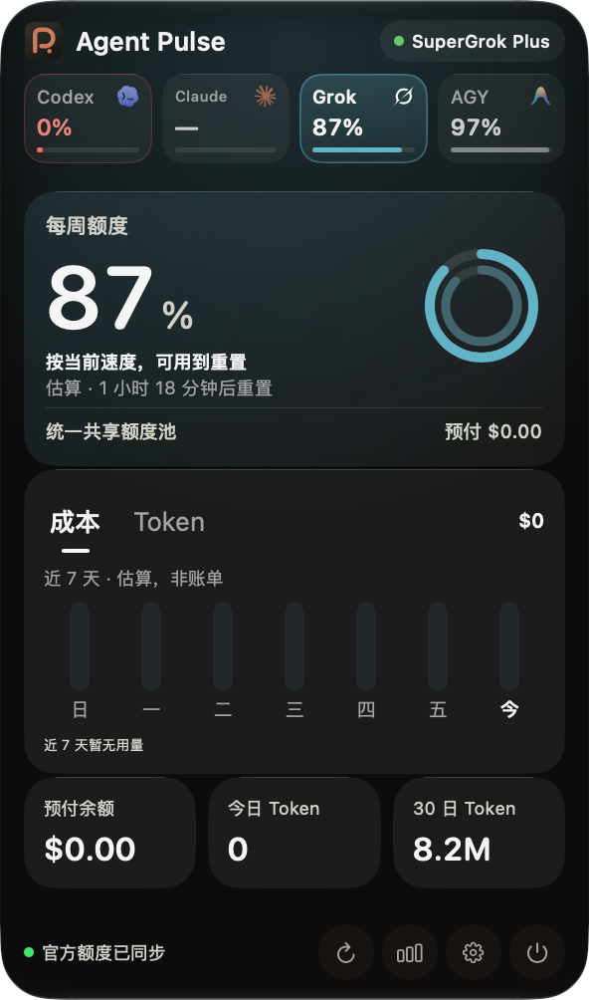
  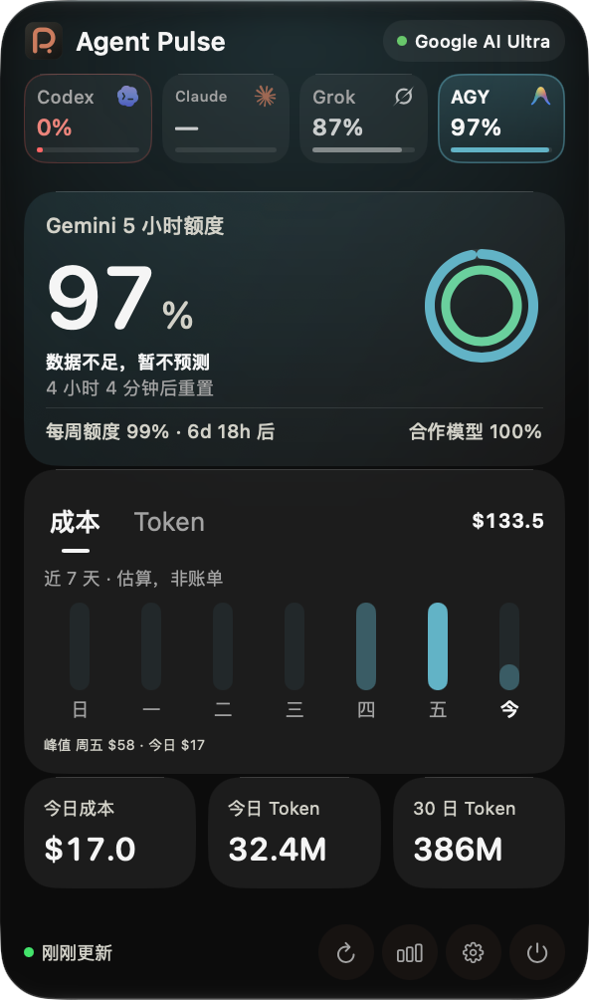
</p>

- **氛围色与同心双环**：背景光晕与磁贴高亮随当前瓶颈窗口余量在青翠、琥珀、绯红之间自然过渡；右侧双环同步展示主窗口与副窗口剩余比例。
- **分端精准语义**：
  - **Codex**：支持 Go / Plus / Pro100 / Pro200 / Pro500 套餐识别、消耗速度预测、Credits 余额与内联额度重置卡入口；
  - **Claude Code**：同步 5 小时与每周窗口比例，跨周期重置后自动提示待新回复刷新；
  - **Grok CLI**：区分官方统一共享额度池与独立预付余额；
  - **Google Antigravity**：拆分 Gemini 5h／每周池、合作模型池与 AI Credits 余额。
- **近 7 天成本 / Token 双视图**：柱状图支持一键切换估算成本与 Token，含未公开单价模型的日期自动标注金额未知下界。

---

## 监控中心（Monitor Center）

监控中心将跨周期用量分析、API 等价成本、社区重置雷达、本地会话连续性管理，以及四路编程代理的接入控制收进同一套暗色玻璃桌面窗口。

<p align="center">
  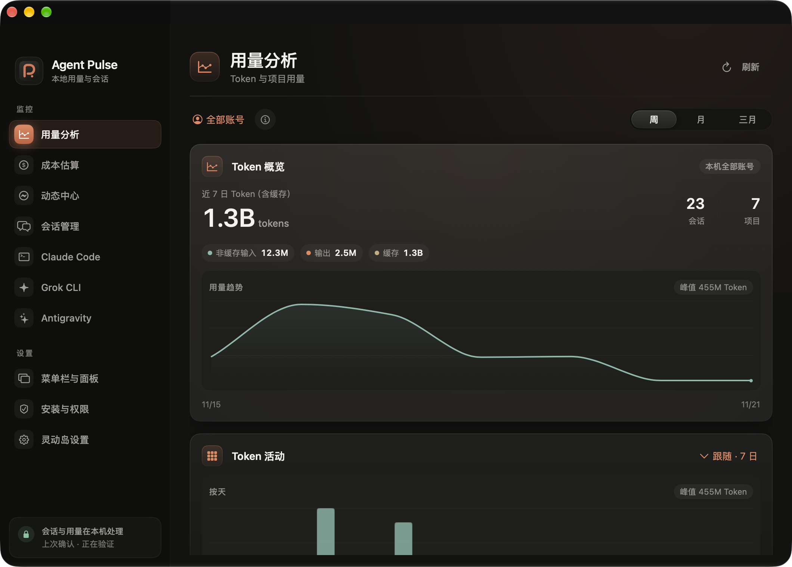
  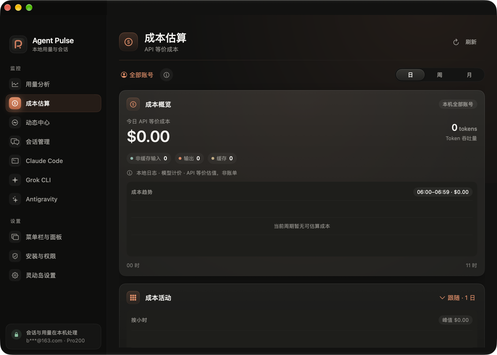
</p>
<p align="center">
  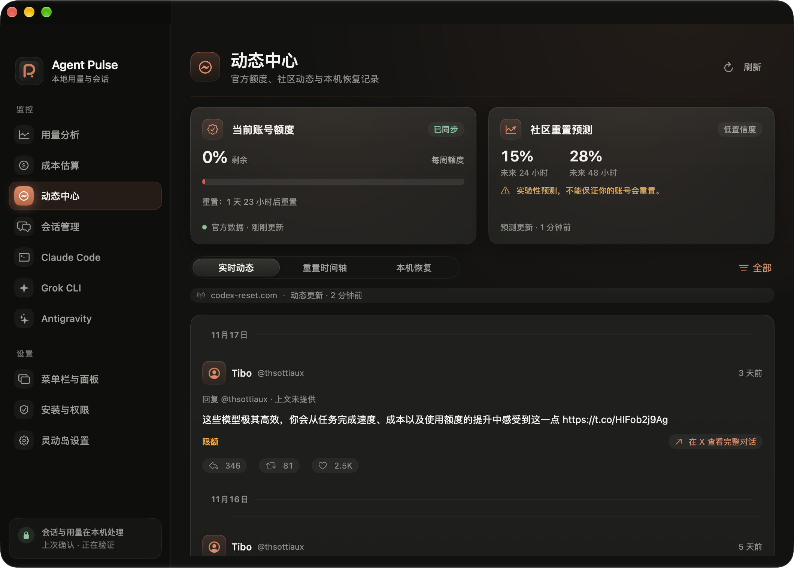
  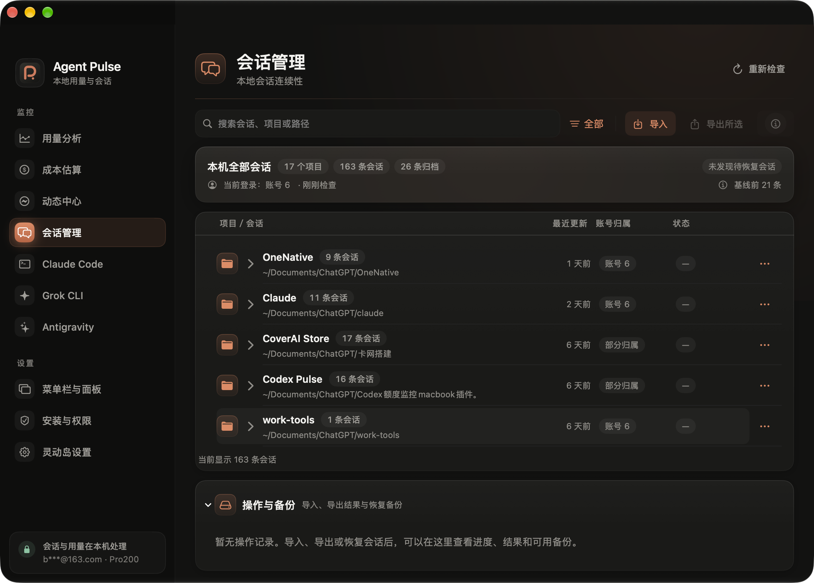
</p>
<p align="center">
  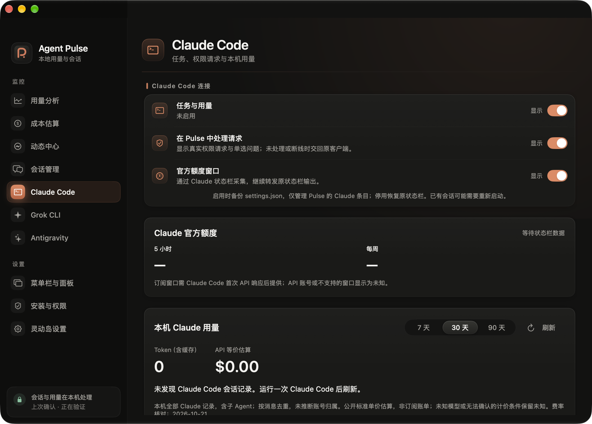
  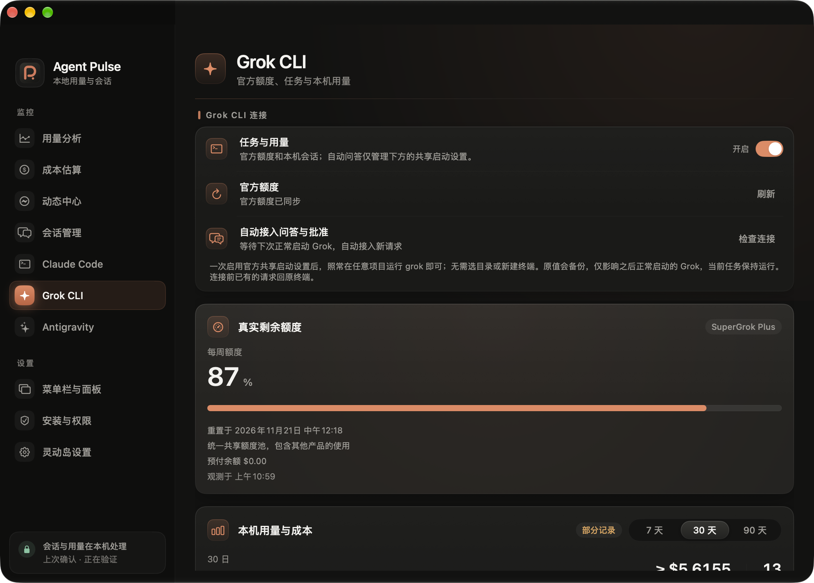
</p>
<p align="center">
  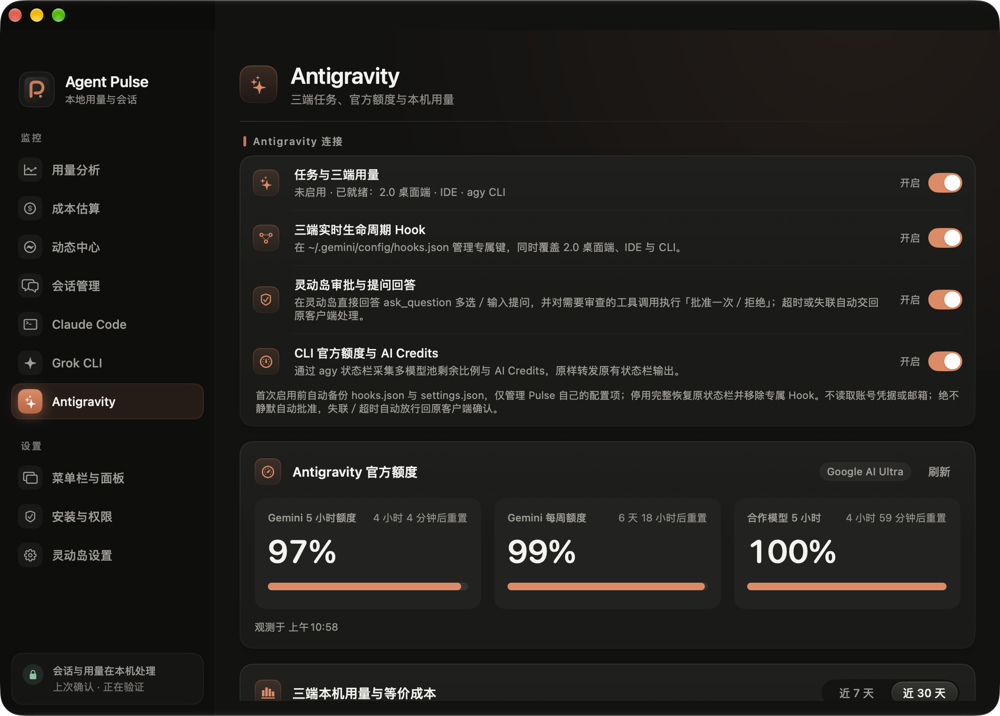
</p>

- **用量分析与成本估算**：按周／月／季统计 Token、缓存命中率与项目排行；Codex、Claude 与 Antigravity 按公开官方标准单价折算 API 等价成本（非订阅账单），未公开单价模型以 `≥` 下界诚实呈现。
- **动态中心**：并排对比当前账号官方额度、社区重置预测与本机恢复历史，所有外部信号均标明来源。
- **会话管理**：支持全文搜索、Markdown／HTML 导出、原始备份、跨目录迁移、桌面项目服务在线重命名，以及多重校验下的独立项目文件夹废纸篓清理。
- **安全可逆的三方代理接入**（均默认关闭，启用前自动完整备份原配置）：
  - **Claude Code**：仅管理 `settings.json` 中本应用专属标记项，停用完整恢复原状态栏。详见 [Claude Code 接入说明](docs/claude-code-integration.md)。
  - **Grok CLI**：仅管理 `$GROK_HOME/config.toml` 的 `cli.use_leader` 官方共享模式，自动连接同用户活跃 `leader` 通道，不接管或重启已有独立终端。详见 [Grok CLI 接入](docs/grok-cli-integration.md) 与 [岛内问答边界](docs/grok-island-questions.md)。
  - **Google Antigravity**：只读聚合 2.0 桌面端、IDE 与 `agy` CLI 三端本地转录及 SQLite 摘要（自动过滤子代理，结合 `presence/*.lock` 文件锁判定存活）；可选挂载 `~/.gemini/config/hooks.json` 的 `"codex-pulse"` 命名键与 `agy` 状态栏转发，本地策略自动放行常规操作，仅在需确认工具或 `ask_question` 时唤醒灵动岛。详见 [Antigravity 接入说明](docs/antigravity-integration.md)。

---

## 个性化设置与权限

灵动岛外观、玻璃面板模块开关、数字单位（`万／亿` 或 `K／M／B`）与通知策略均在监控中心即时预览并实时生效。

<p align="center">
  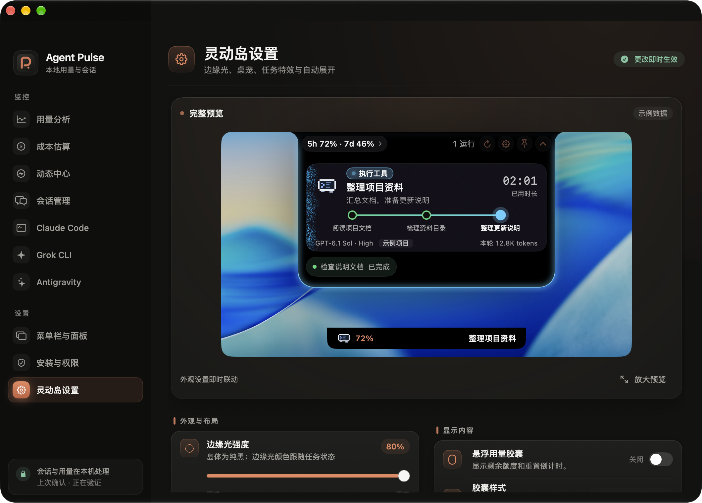
  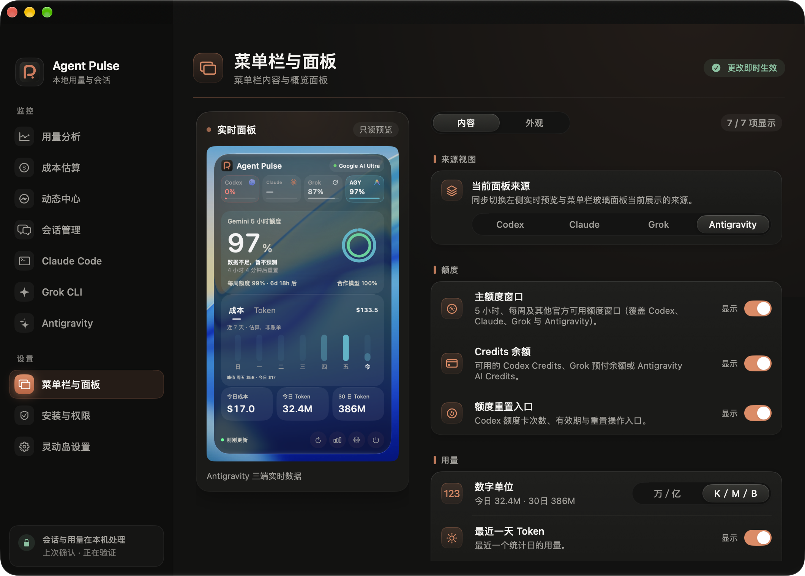
</p>

<details>
<summary>查看「安装与权限」页面（v2.2.0 · Build 37）</summary>
<p align="center">
  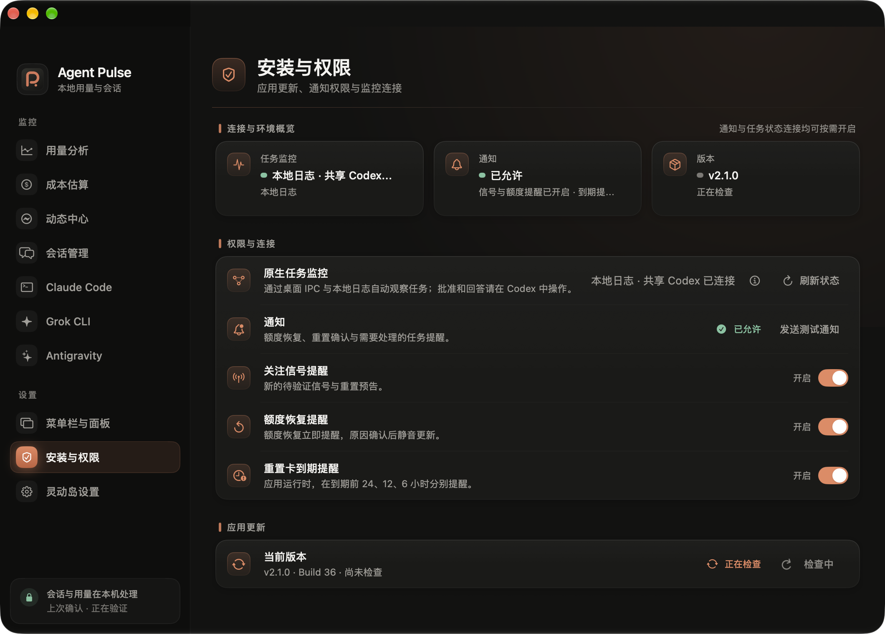
</p>
</details>

---

## 下载与安装

前往 [GitHub Releases (`v2.2.0`)](https://github.com/suguxiaojie/agent-pulse/releases/tag/v2.2.0) 下载对应架构安装包：

| Mac 处理器 | 安装包下载 |
|---|---|
| **Apple Silicon（M1 / M2 / M3 / M4）** | [CodexNotchMonitor-v2.2.0-arm64.dmg](https://github.com/suguxiaojie/agent-pulse/releases/download/v2.2.0/CodexNotchMonitor-v2.2.0-arm64.dmg) |
| **Intel (`x86_64`)** | [CodexNotchMonitor-v2.2.0-x86_64.dmg](https://github.com/suguxiaojie/agent-pulse/releases/download/v2.2.0/CodexNotchMonitor-v2.2.0-x86_64.dmg) |

1. 打开对应架构的 `.dmg`，将 **Agent Pulse**（`CodexNotchMonitor.app`）拖入「应用程序（`/Applications`）」。
2. 启动应用。Codex 官方额度需本机已登录 Codex／ChatGPT 桌面端；Claude Code、Grok CLI 与 Google Antigravity 可在监控中心按需开启。
3. 安装包采用临时签名（Ad-hoc Signed），尚未经过 Apple 公证；首次打开若遇系统拦截，请在核对 Release `SHA256SUMS-v2.2.0.txt` 后于「系统设置 → 隐私与安全性」中点击允许。
4. 为保持老用户无缝升级，Bundle ID（`com.coverai.codex-notch-monitor`）、可执行文件名与本地数据目录均保持兼容，覆盖安装后原有配置与历史记录完整保留。

---

## 数据来源与隐私边界

| 维度 | 数据来源与安全承诺 |
|---|---|
| **官方额度与套餐** | 本机 Codex App Server、Claude 状态栏、官方 `grok` `_x.ai/billing`、Antigravity `agy` 状态栏（显式剥离 `email` 与未知字段） |
| **凭据零接触** | **不读取、不保存、不上传** `auth.json`、`.pbtxt`、OAuth Token、Cookie、API Key 或钥匙串机密 |
| **实时任务与问答** | Codex 桌面 IPC／OneNative 活动轮次代理；Claude 与 Antigravity 隔离命名 Hook（2 分钟上限，失联自动放行回原客户端）；Grok 同用户 `leader` Socket |
| **Token 与等价成本** | 只读解析本机结构化会话日志（不读模型内部 `thinking` 原文）；成本按官方公开 API 费率估算，不代表订阅扣费账单 |

---

## 本地构建与验证

```bash
# 运行全量单元与端到端回归测试（含 Codex / Claude / Grok / Antigravity）
zsh scripts/test.sh

# 构建当前架构 Release 应用包或指定架构 DMG
zsh scripts/build-app.sh arm64
zsh scripts/build-dmg.sh arm64
zsh scripts/build-dmg.sh x86_64
```

## 开源许可

本项目基于 [MIT License](LICENSE) 开源；第三方组件与设计致谢详见 [Resources/ThirdPartyNotices.txt](Resources/ThirdPartyNotices.txt)。
